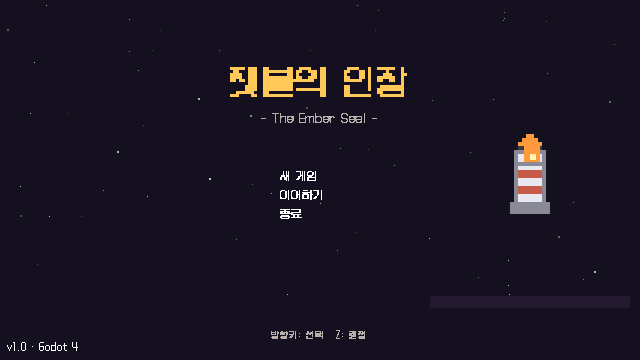
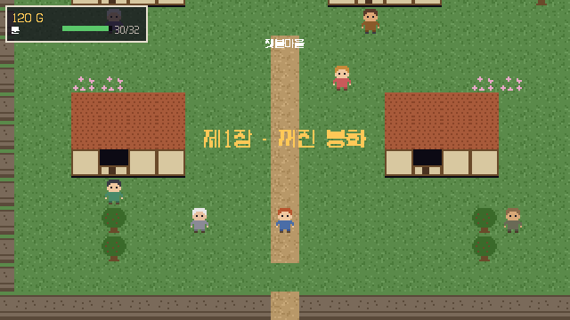
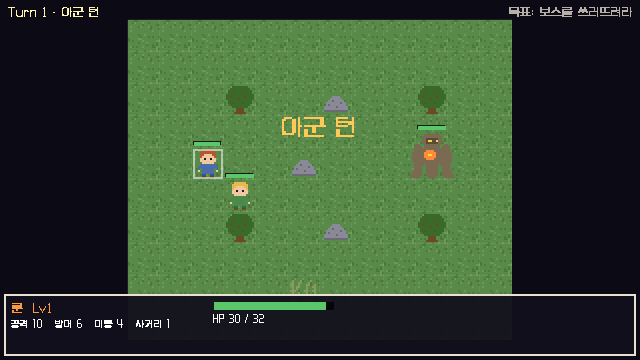
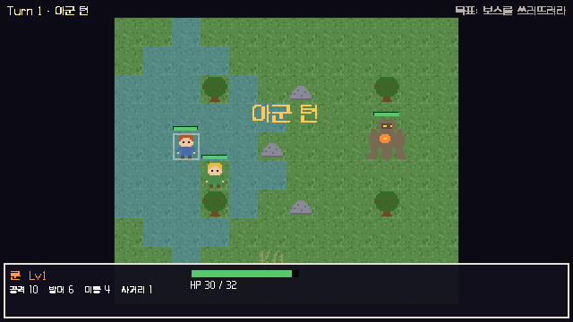

# 잿불의 인장 (The Ember Seal)

1990년대 후반 휴대용/PC RPG의 감성을 현대적으로 압축한, 약 1시간짜리 완성형 2D 픽셀 타일 전술 RPG.

- 엔진: Godot 4.x + GDScript
- 해상도: 640x360 픽셀 퍼펙트
- 외부 에셋 0, 외부 서버/API 0 — 완전 오프라인 실행
- 플레이 시간: 약 50~70분 (처음부터 엔딩까지)



## 실행 방법

### 라이브 데모 (설치 없이 브라우저에서)

https://jeiel85.github.io/ember-seal/

### Godot 에디터에서

1. Godot 4.7+ 다운로드: https://godotengine.org/download
2. 이 저장소를 클론한 뒤 Godot에서 `project.godot` 열기
3. F5 키로 실행 — 추가 설정 없이 바로 플레이 가능

### Windows 실행 파일

GitHub Releases에서 빌드를 내려받아 실행.

## 조작

| 키 | 동작 |
| --- | --- |
| 방향키 / WASD | 이동, 커서 이동 |
| Z / Enter / Space | 확인, 대화 진행, 조사 |
| X / Esc | 취소, 이동 취소 |
| Tab | 메뉴 열기, (전투 중) 턴 종료 |

마우스 없이 키보드만으로 전체 게임 플레이 가능.

## 게임 소개

봉화가 꺼진 잿불마을에서 시작해, 필드와 던전을 지나 잿불 등대의 진실에 도달하는 3막짜리 이야기.

- 제1장 꺼진 봉화: 잿불마을, 동료 합류(세라), 첫 보스 흙 파수꾼
- 제2장 여울의 진실: 여울마을, 동료 합류(아이리, 카일), 망자의 갱도, 중간보스 심연의 사도, 이야기의 반전
- 제3장 잿불의 등대: 등대 외곽, 최종보스 재의 군주, 엔딩 크레딧



### 구성

| 항목 | 수량 |
| --- | --- |
| 탐험 지역 | 7개 (마을 2, 필드 2, 던전 1, 등대 지역 2) |
| 전투 | 필수 8회 + 선택 3회 |
| 파티 캐릭터 | 4명 (검사, 궁수, 약사, 유랑검사) |
| 레벨 상한 | 10 (엔딩 목표 6~8, Lv3/5/7 스킬 습득) |
| 장비 | 15종 (무기, 방어구, 장신구) |
| 아이템 | 8종 |
| 사이드 퀘스트 | 2개 |

## 전투 시스템

타일 기반 턴제 전술 RPG.

- 이동 범위, 공격 범위 표시
- 예상 피해량 표시
- 행동 취소(이동 되돌리기), 턴 종료
- 적 AI: 사거리 계산, 최적 대상 공격, 접근, 저HP 후퇴
- 스킬(전투당 사용 제한), 아이템, 독 상태이상
- 경험치: 처치 + 파티 분배, 레벨업과 스킬 습득
- 승패 처리, 게임 오버 후 마지막 기록 재시작





## 저장

- 메뉴(Tab) 기록: 수동 저장
- 지역 진입 시 자동 저장
- 저장 내용: 위치, 스토리 진행도, 파티(레벨/경험치/HP/장비), 아이템, 퀘스트 플래그, 상자와 필드 적 기록, 목표, 플레이 시간
- 저장 파일: user://save.json

## 기술 노트

- Godot 4.7, GDScript, gl_compatibility 렌더러(웹 포함 전 플랫폼 동작)
- 640x360 viewport stretch, nearest 필터링 픽셀 퍼펙트
- 그래픽/사운드 전부 런타임 절차 생성: 문자열 아트 기반 스프라이트, 톤/노이즈 합성 WAV. 이미지·오디오 파일 없음
- 캐릭터, 스킬, 아이템, 장비, 적, 맵, 전투 데이터는 전부 data/ 아래 JSON으로 코드와 분리
- 입력: 키보드 전용, input map에 정의

### 웹 한글 폰트

Godot 웹 빌드는 TTF 동적 폰트의 한글 렌더링에 문제가 있어, Galmuri 폰트를 런타임에 렌더링해 만든 BMFont 비트맵 폰트(fonts/galmuri11_bmp.fnt, fonts/galmuri9_bmp.fnt)를 사용. 비트맵 폰트는 FreeType/HarfBuzz를 경유하지 않아 전 플랫폼에서 동일하게 렌더링됨. 생성 스크립트는 이 저장소 커밋 이력 참고.

## 테스트

```
godot --headless --path . res://test/test_runner.tscn
```

- 데이터 무결성(스킬/아이템/적/맵/전투 참조), 맵 지형·오브젝트 좌표 검증
- 성장 공식, 아이템/장비, 세이브-로드 왕복
- 실제 전투 씬 + AI로 11개 전투 전부 승리 시뮬레이션
- 새 게임 시작부터 엔딩까지 전 스토리 플레이 시뮬레이션 (퀘스트, 합류, 상점, 상자 포함)

실패 0건 기준으로 릴리스.

## 프로젝트 구조

```
scripts/
  core/      game_state, db, save_manager, audio, pixel_art, ui_kit, events
  explore/   탐험 씬, HUD, 메뉴, 상점
  battle/    전투 씬 (타일 SRPG)
  ui/        타이틀, 대화창, 엔딩, 게임 오버, 토스트
  main.gd    씬 전환 관리
scenes/      최소 골격 .tscn (내용은 코드 구축)
data/        JSON 데이터 (characters, skills, items, equipment, enemies, levels, shops, texts)
  maps/      7개 탐험 맵 (ASCII 타일맵 + NPC/출구/상자/필드 적/이벤트)
  battles/   11개 전투 맵
test/        headless 테스트 러너, 스크린샷 도구
fonts/       Galmuri 폰트 (OFL) + 비트맵 폰트
```

## 라이선스

- 코드: MIT License (LICENSE 참고)
- 폰트: Galmuri — SIL Open Font License 1.1 (fonts/OFL.txt 참고)
